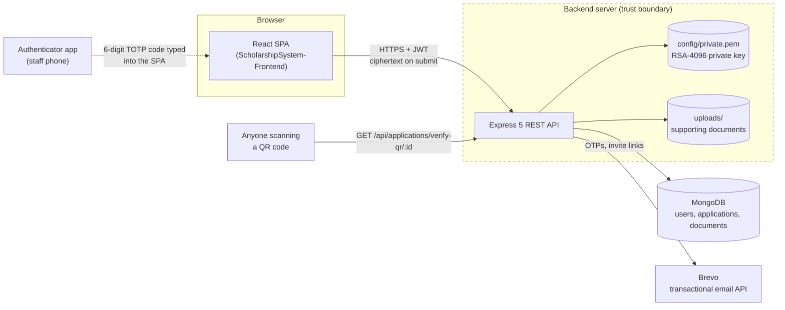
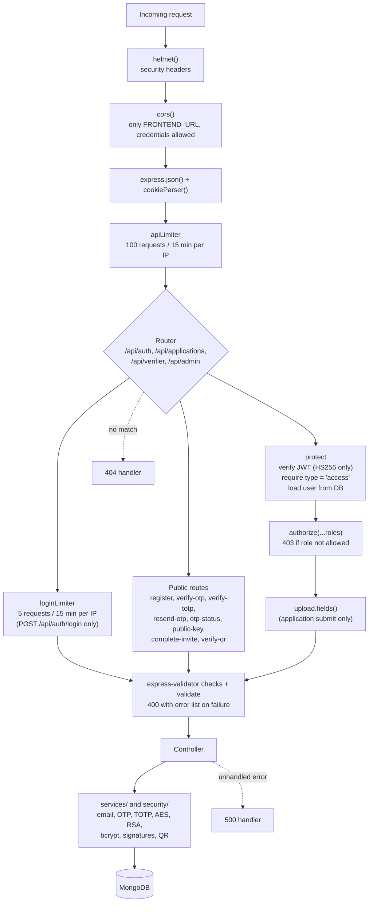
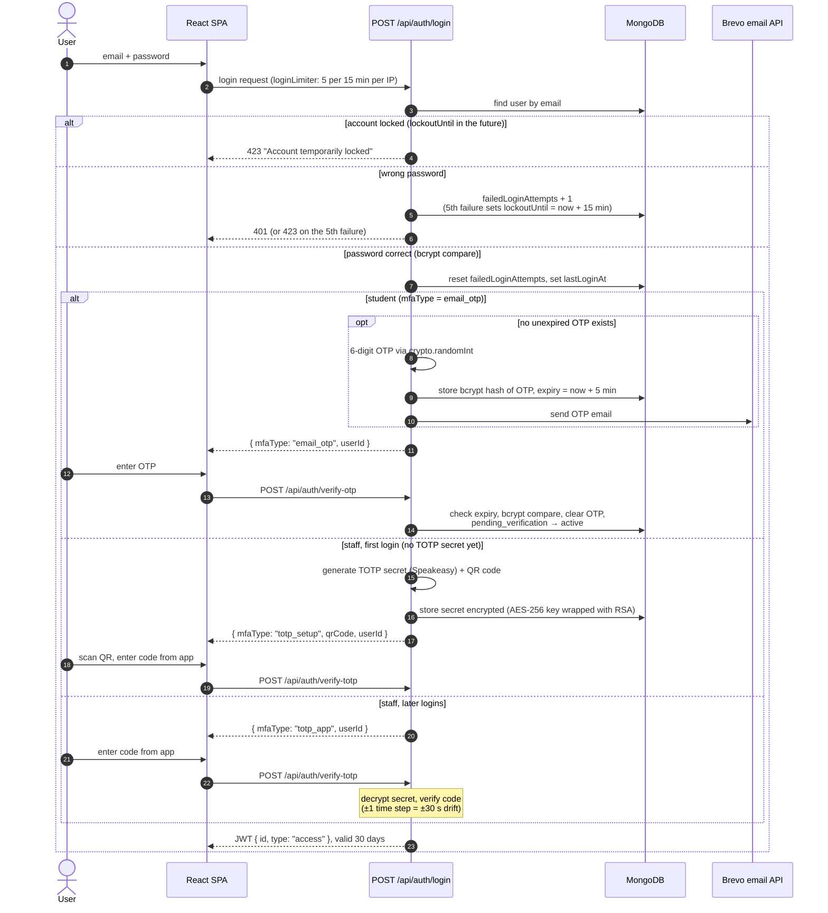
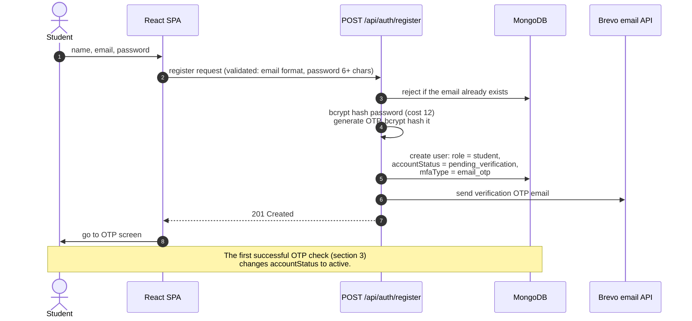
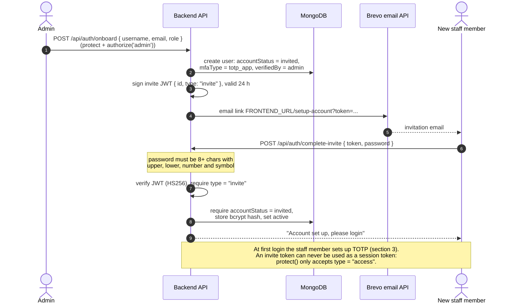
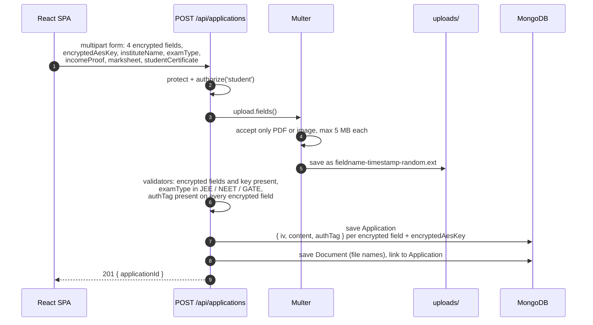
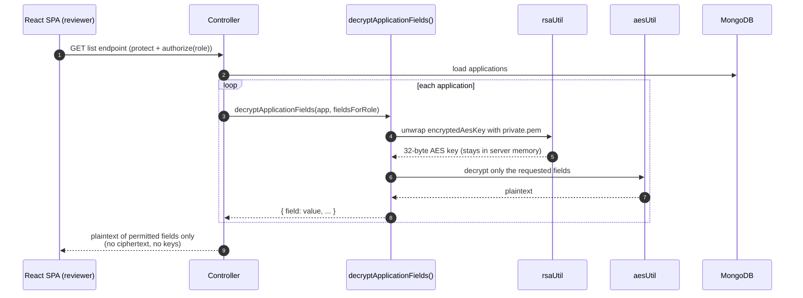
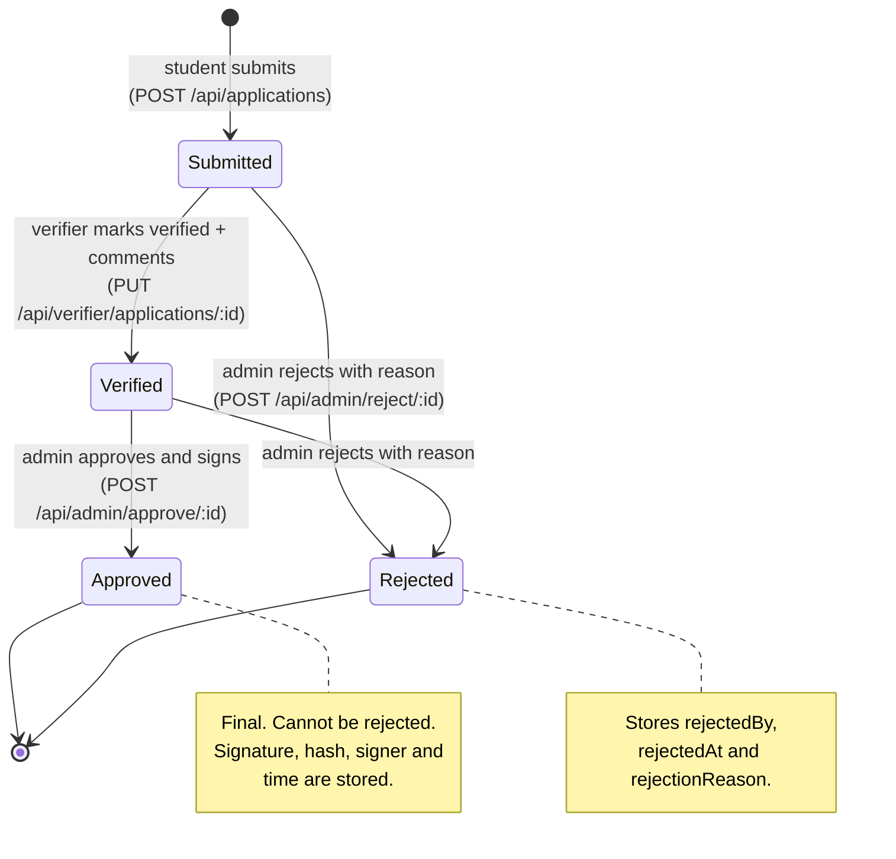
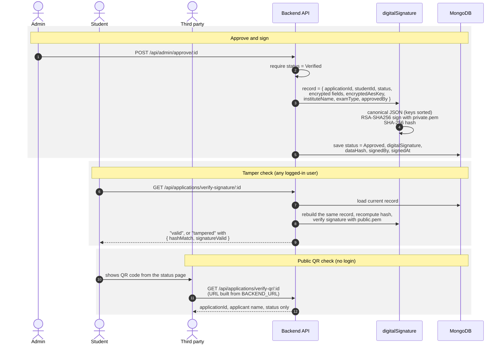
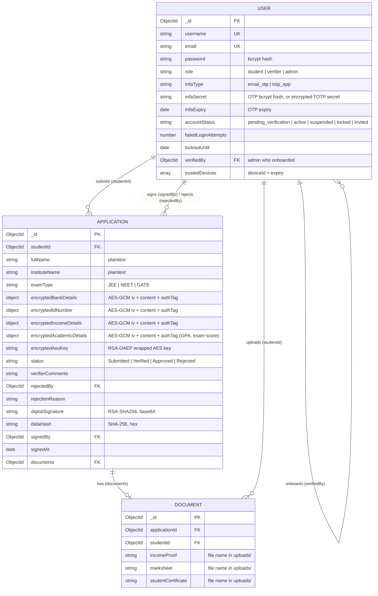

# SafeApply Backend Architecture

This document explains how the SafeApply backend is put together, for anyone setting it up, using it, or contributing to it. It covers the API, authentication, the encryption model, the application workflow and the data model.

SafeApply is a scholarship application system with three roles:

- **Student:** registers, submits encrypted applications with supporting documents, and tracks their status.
- **Verifier:** staff member who reviews applications and marks them as verified.
- **Admin:** staff member who approves or rejects verified applications, onboards staff and manages users.

The React client has its own architecture document: [Frontend Architecture](https://github.com/USER1043/ScholarshipSystem-Frontend/blob/main/docs/ARCHITECTURE.md).

## Contents

1. [System context](#1-system-context)
2. [Request pipeline](#2-request-pipeline)
3. [Login and MFA](#3-login-and-mfa)
4. [Student registration](#4-student-registration)
5. [Staff invite onboarding](#5-staff-invite-onboarding)
6. [Receiving an application](#6-receiving-an-application)
7. [Reviewing: server-side, least-privilege decryption](#7-reviewing-server-side-least-privilege-decryption)
8. [Application lifecycle](#8-application-lifecycle)
9. [Approval signing, tamper check and QR verification](#9-approval-signing-tamper-check-and-qr-verification)
10. [Data model](#10-data-model)
11. [Keys and secrets](#11-keys-and-secrets)
12. [Security model and known limitations](#12-security-model-and-known-limitations)
13. [Contributing](#13-contributing)

---

## 1. System context

Everything inside the dashed box runs on the backend server. The browser only ever sends sensitive fields to the server as ciphertext.



## 2. Request pipeline

Every request passes through the global middleware in `app.js`, then through the route-specific middleware declared in `routes/`.



The exact order of `protect`, `authorize`, `upload` and the validators is set per route in `routes/*.js`; the diagram shows the most complete case (submitting an application). Two routes use `protect` without `authorize`, because any logged-in role may call them: `GET /api/applications/verify-signature/:id`, and `GET /api/applications/documents/:filename`, which does its own owner-or-staff check in the controller.

### Where code lives

| Folder | Responsibility | Key files |
| --- | --- | --- |
| `routes/` | URL → middleware chain → controller | `authRoutes.js`, `applicationRoutes.js`, `verifierRoutes.js`, `adminRoutes.js` |
| `controllers/` | Request handling and business rules | `authController.js`, `applicationController.js`, `verifierController.js`, `adminController.js` |
| `middleware/` | Cross-cutting request checks | `authMiddleware.js` (`protect`), `roleMiddleware.js` (`authorize`), `rateLimiter.js`, `uploadMiddleware.js`, `validateInput.js` |
| `security/` | Cryptography | `encryption/aesUtil.js`, `encryption/rsaUtil.js`, `encryption/applicationCrypto.js`, `hashing/hashUtil.js`, `signature/digitalSignature.js`, `encoding/qrUtil.js` |
| `services/` | External integrations and one-time codes | `emailService.js`, `otpService.js`, `totpService.js` |
| `models/` | Mongoose schemas | `User.js`, `Application.js`, `Document.js` |
| `config/` | Database, JWT secret and RSA keys | `db.js`, `jwt.js`, `public.pem`, `private.pem` (git-ignored) |
| `scripts/` | Admin account maintenance | `seedAdmin.js`, `resetAdmin.js` |

## 3. Login and MFA

Every login needs two factors: the password, and then either an email OTP (students) or an authenticator app code (staff). A JWT is issued only after the second factor succeeds.



`POST /api/auth/resend-otp` refuses to send a new code while the current one is still valid, and `POST /api/auth/otp-status` returns the seconds remaining so the UI can show a countdown.

## 4. Student registration

Only students can self-register; staff accounts are created through [invite onboarding](#5-staff-invite-onboarding).



## 5. Staff invite onboarding

Verifier and Admin accounts can only be created by an admin. The new staff member chooses their own password; the admin never sees it.



## 6. Receiving an application

The browser encrypts the sensitive fields before sending them (see the [frontend document](https://github.com/USER1043/ScholarshipSystem-Frontend/blob/main/docs/ARCHITECTURE.md#5-submitting-an-application-browser-side-encryption)). The server stores the ciphertext as received and never sees the plaintext at this stage.



## 7. Reviewing: server-side, least-privilege decryption

Decryption happens only on the server, in `decryptApplicationFields()` (`security/encryption/applicationCrypto.js`). AES keys are never sent to any browser, and each endpoint asks only for the fields its role needs.



| Endpoint | Role | Decrypted fields returned |
| --- | --- | --- |
| `GET /api/applications/my` | Student (own applications only) | bank details, ID number, income, GPA, exam score |
| `GET /api/verifier/applications` | Verifier | ID number, income, GPA, exam score |
| `GET /api/admin/applications` | Admin | income, GPA, exam score |

Supporting documents are downloaded separately through `GET /api/applications/documents/:filename`, which allows only the student who uploaded the file, a verifier or an admin.

## 8. Application lifecycle

Each transition is enforced in the controllers, not only in the UI.



- A verifier can only set the status to `Verified`; any other value returns 403.
- An admin can approve only an application that is already `Verified`.
- An admin can reject at any stage except `Approved`.

## 9. Approval signing, tamper check and QR verification

Approvals are digitally signed so that any later change to an approved record can be detected, and so each approval can be traced to the admin who made it.



Because the signed record contains the **encrypted** fields, signing and verification never need to decrypt anything.

## 10. Data model



## 11. Keys and secrets

| Secret | Protects | Where it lives | If it is lost or leaked |
| --- | --- | --- | --- |
| `JWT_SECRET` | Session and invite tokens (HS256) | `.env` (min. 32 chars, checked at startup) | **Leaked:** anyone can forge tokens for any user; rotate it (all users are logged out). **Lost:** set a new one; users log in again. |
| `config/private.pem` (RSA-4096) | Unwrapping every AES key; signing approvals | Server disk, git-ignored | **Leaked:** all stored applications and staff TOTP secrets can be decrypted, and approvals can be forged. **Lost:** all stored data becomes permanently undecryptable. Back it up. |
| `config/public.pem` | Wrapping AES keys (browser); verifying signatures | Server disk, served by `GET /api/auth/public-key` | Public by design. It must match `private.pem`. |
| Per-application AES-256 key | One application's sensitive fields | Stored only in wrapped (RSA-encrypted) form in `encryptedAesKey` | Plain form exists only briefly in the student's browser and in server memory during decryption. |
| Staff TOTP secret | Staff second factor | `mfaSecret`, AES-encrypted with an RSA-wrapped key | Re-enroll the staff member. |
| `BREVO_API_KEY` | Sending OTPs and invites | `.env` | **Leaked:** anyone can send email as your verified sender; revoke it in Brevo and create a new key. |

If either `.pem` file is missing, `rsaUtil.ensureKeys()` generates a **new** key pair. On a server with existing data, that makes everything already stored undecryptable.

## 12. Security model and known limitations

**What the design protects against**

- A leaked database or backup: sensitive fields are ciphertext, and the key needed to read them is not in the database.
- Sensitive data showing up in logs or intermediaries before it reaches the server: it is encrypted in the browser.
- Staff seeing more than they need: each role receives only its permitted fields (section 7).
- Undetected changes to approved records: signatures and hashes (section 9).
- Password guessing: account lockout plus per-IP rate limits.
- Forged or misused tokens: required strong secret, HS256 only, typed tokens.

**What it does not protect against, and current gaps**

- **Not end-to-end encryption.** The server holds the RSA private key and can decrypt everything. This is intentional so staff can review applications, but a fully compromised server exposes all data.
- **Decrypted fields travel over the API.** Production deployments must use HTTPS.
- **Uploaded documents are stored unencrypted** in `uploads/`.
- **Student passwords only need 6+ characters.** The strong-password rule applies only to staff invite setup.
- **Trusted devices are not used.** A `deviceId` is issued and stored when requested, but login never checks it, so it does not skip MFA.
- **`registerUser` sets `mfaEnabled`**, which is not in the `User` schema and is silently ignored.

## 13. Contributing

### Adding a protected route

1. Add the handler to the right file in `controllers/`.
2. Register it in `routes/`, in this order: `protect` → `authorize('role', ...)` → validators → `validate` → handler.

```js
router.post(
  "/example/:id",
  protect,
  authorize("admin"),
  [check("reason", "Reason is required").not().isEmpty(), validate],
  exampleHandler,
);
```

3. Don't rely on the frontend's route guards for access control; the server check above is what enforces it.

### Adding a new encrypted field

1. **Frontend:** encrypt the value with `encryptWithAES` in `ApplyScholarship.jsx` and append it to the form data.
2. **Model:** add an `{ iv, content, authTag }` field to `models/Application.js`.
3. **Submit:** map it in `submitApplication` and add a validator in `routes/applicationRoutes.js`.
4. **Decryption:** add it to `ENCRYPTED_FIELDS` in `security/encryption/applicationCrypto.js`.
5. **Access:** add it to the field list of each role that needs it (`applicationController.js`, `verifierController.js`, `adminController.js`).
6. **Signature:** if it must be tamper-evident, add it to the signed record in **both** `approveScholarship` and `verifySignature`. The two records must stay identical, or every check will report "tampered".
